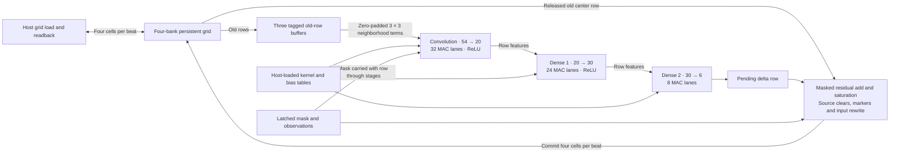
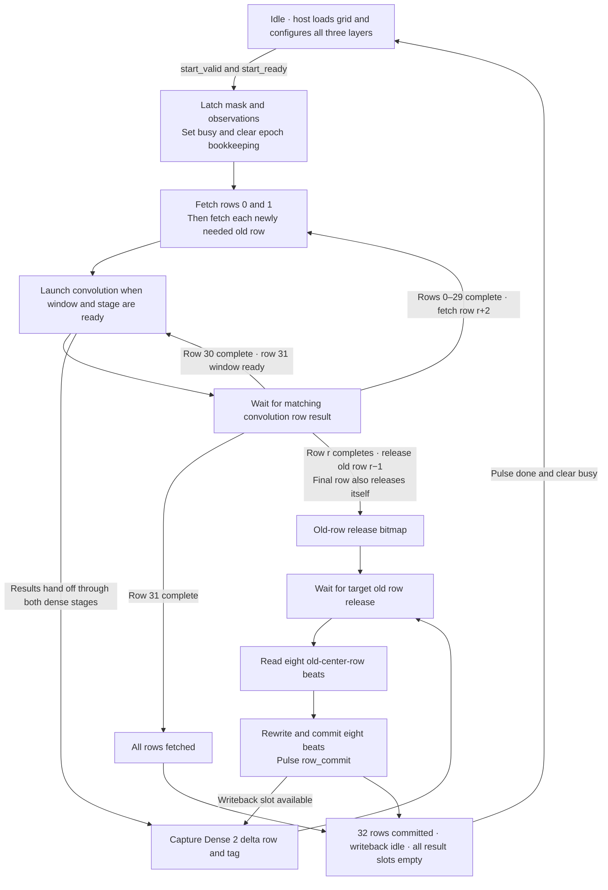

# Current CartPole NCA epoch core

The portable core advances one 32 × 32 × 6 grid by one epoch. The caller supplies the cell update mask and scaled observations. The default format uses 32-bit state, 24-bit weights and 62-bit accumulators.

## Datapath

Each arithmetic stage adds bias and uses nearest-even rounding and signed saturation at its output. Ready/valid transfers carry the row, epoch tag and mask. Convolution, Dense 1 and Dense 2 can operate on different rows concurrently. Masked cells skip learned MAC work while the mandatory source rewrites still execute.

## Control

The grid read arbiter gives writeback priority over window fill. The memory defers a read that collides with a write to the same address. The release bitmap protects old-generation data until convolution has finished reading it. The host can load or read the grid while idle. G5 physical mapping and action-level integration remain pending.

See the [RTL inventory](../../rtl/core/README.md) and [epoch-core interface and ownership notes](ROW_PIPELINE_EPOCH_CORE.md).
