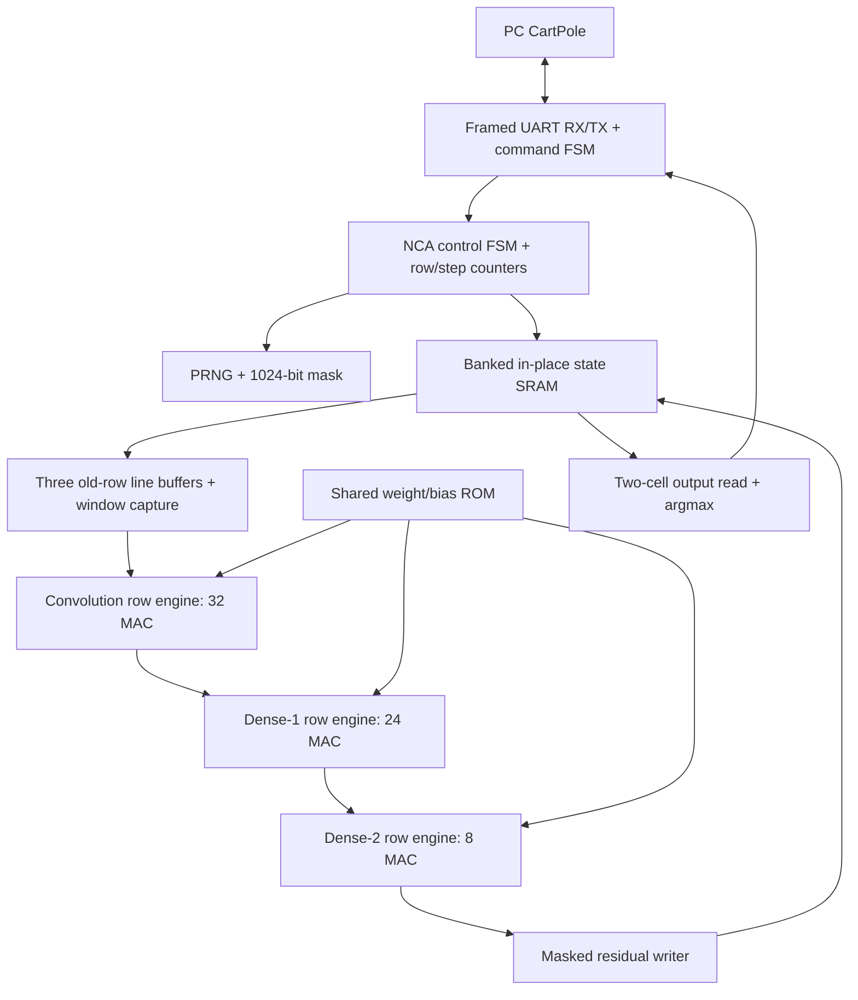

# NCA CartPole FPGA Accelerator — RTL Architecture Specification

**Status:** Implementation baseline, revision 1.0 (2026-10-27)  
**Target:** Terasic DE1-SoC, Cyclone V SoC `5CSEMA5F31C6`  
**Scope:** Inference acceleration of the trained neural cellular automaton (NCA) from *Towards Self-Organized Control: Using Neural Cellular Automata to Robustly Control a Cart-Pole Agent* (Variengien et al., arXiv:2106.15240v2). **Not** the subsequent spiking/neuromorphic/autopoietic architecture.  
**Implementation language:** Synthesizable SystemVerilog; Quartus Prime targeting Cyclone V.  
**Decision authority:** This document fixes the architectural choices. Any deviation affecting behavior, interface, data width, bank mapping, or scheduling requires an explicit design-change note and revalidation.

## 0. Executive requirements and non-goals

### Required

1. Implement a persistent **32 × 32 × 6** NCA grid (1,024 cells, six scalar channels each).
2. Implement the paper's shared local neural rule: 20 learned `3×3×6` filters, ReLU, a `20→30` dense layer and ReLU, a `30→6` dense layer with **linear** output, stochastic residual update.
3. Train weights **offline**. FPGA inference never modifies weights. Include the paper's eight fixed input cells and two output cells, with exact placement and channel semantics taken from the software golden model.
4. Preserve synchronous **generation semantics**: every evaluated neighborhood for CA step `t` uses state `S[t]`, although physical row execution is staggered.
5. Sweep rows `r=0…31`, processing all 32 column positions as **one row-synchronous batch**. Every cell of the row crosses a stage boundary together. Different rows overlap in the four-stage pipeline.
6. Use **in-place writes**, with proof of read-before-write safety, not a full second grid state buffer.
7. Skip unnecessary switching for masked cells without changing fixed row-level stage latencies. Stochastic decision probability is 0.5 per cell per CA step, subject to fixed-cell masks.
8. Support a random integer **50–60 CA steps inclusive** per CartPole action, seeded/reproducible for verification.
9. Implement a reliable, packetized link to a PC running CartPole. PC waits for FPGA action; **no hard 20 ms deadline**. Nonetheless maximize measured throughput and minimize area/power subject to correct behavior.
10. Use **16-bit signed fixed point**, explicit rounding and saturation, bit-accurate software reference, and long-horizon policy validation against original FP32.

### Non-goals for v1

- On-chip training, backpropagation, STDP, structural plasticity, or event-driven neuromorphic execution.
- FPGA simulation of CartPole physics (host PC does that).
- A fully parallel 1,024-engine design, FP32 datapath, or a fully asynchronous clockless FPGA.
- Interleaving different CA iterations, dynamic compacting of active cells, or variable per-column finish times.
- Reproducing training-only pool sampling, noise/damage injection, reward computation, Adam, or Deep Q-learning on FPGA.

### Success criteria

- Exact state equivalence to the bit-accurate fixed-point golden model after **every** CA step for deterministic test vectors.
- No stale/new-generation mixing, including first/last rows, disabled updates, and output positions.
- All 32 logical column positions finish each of the three layers in lockstep.
- Host protocol completes 50–60 iterations, returns correct action and status, and supports reproducible reset.
- Synthesis and timing closure on the DE1-SoC at a measured viable frequency; report cycles/CA-step, cycles/action, BRAM, DSP, ALM/LE, and energy/power if measurable.
- Quantized control performance reported against FP32 across many seeded episodes; no unverified claim of equivalence or policy quality.

## 1. Algorithmic specification

### 1.1 Coordinate and tensor conventions

- `r` = row (`0..31`, top to bottom); `c` = column (`0..31`, left to right); `ch` = channel (`0..5`).
- Cell state `S[r][c][ch]`. Neighborhood input ordered **row-major offset then channel**:

  `k = ((dr+1)*3 + (dc+1))*6 + ch`, with `dr,dc ∈ {-1,0,+1}`.

- For any neighbor coordinate outside `[0,31]`, substitute **all-six-channel zero** state (zero padding, not wraparound).
- `x[c][k]` is the flattened 54-element neighborhood of `(r,c)`.
- Filter output index `f∈[0,19]`; hidden index `h∈[0,29]`; output channel `o∈[0,5]`.
- Host and RTL use this exact order for weight export, checksum, and readback.

### 1.2 Local function

For every cell eligible for neural update:

```text
p[c,f] = ReLU( bp[f] + Σ(k=0..53) Wp[f,k] * x[c,k] )       # 20 values
h[c,j] = ReLU( bh[j] + Σ(f=0..19) Wh[j,f] * p[c,f] )      # 30 values
d[c,o] =           bo[o] + Σ(j=0..29) Wo[o,j] * h[c,j]    # 6 deltas
S_next[r,c,o] = S_old[r,c,o] + mask[r,c] * d[c,o]
```

**All weights are shared by every cell**, not learned individually. Bias existence/shape must be established by inspecting the exported TensorFlow variables; see §2.3. Do not silently assume biases if absent in the actual checkpoint. The original paper lists **1,854 parameters**, inconsistent with the stated 1,860 weight elements even without biases, so the weight checkpoint is authoritative and any discrepancy is a release blocker until explicitly reconciled.

### 1.3 Fixed channels and cell types

- Information channel: index `0`.
- Input identity channel: index `2` (1 at inputs, 0 elsewhere).
- Output identity channel: index `3` (1 at outputs, 0 elsewhere).
- Hidden channels: indices `1`, `4`, `5`.
- Eight input positions duplicate the four physical observations; two output positions read their channel-0 values. **Do not guess coordinates**: create `cell_map.hex` from the paper's released reference implementation and include a human-readable `cell_map.csv`. These become mandatory build artifacts.
- In input cells the state supplied to the CA is `[scaled_observation, 1, 1, 0, 1, 1]` (subject to confirmation of exact reference code); these cells bypass neural updates entirely.
- On other cells, channels `2` and `3` are immutable identifier metadata; the update engine may compute six deltas but write masking must preserve these two identifiers. For outputs/intermediates, write channels `0,1,4,5` only. Confirm this interpretation against reference state constraints; do not substitute a different mask without a golden-model update.
- Compute proposed local deltas for enabled non-input cells. Inactive cells retain **all** channels. Output cells remain updateable in their non-identifier channels.
- Random initialization follows the authors' implementation, with fixed cell markers imposed afterward. The exact initializer/range for each non-identifier channel must be extracted from the executable reference; parameterize seed and capture initial state as a test fixture. Avoid silently substituting a different distribution.

### 1.4 Observation/action loop

1. Host performs CartPole reset and sends a `RESET` packet carrying seed/configuration (or invokes a known initialization mode).
2. FPGA initializes NCA states, fixed metadata, and PRNGs; returns `READY`.
3. Host sends four **already scaled and quantized** observation values in explicit order `[cart_position, cart_velocity, pole_angle, pole_angular_velocity]` (mapping to input positions defined by `cell_map`). Observation scaling must use the original reference's constants and be documented/exported in `model_manifest.json`.
4. FPGA overwrites eight fixed input cells, chooses CA step count `N∈{50,…,60}`, runs `N` iterations, then reads the two designated output cells' channel-0 values.
5. FPGA selects `action = 0` if left-Q > right-Q, else `action = 1` (this is a chosen deterministic **tie-right** convention; compare against Python reference and change together if needed). Common positive ×100 Q scaling is omitted because argmax is unaffected.
6. FPGA returns action, step count, optional raw output values and cycle count; host advances CartPole and sends the next observation. Internal grid state persists across actions.
7. Host explicitly resets on episode termination. FPGA never restarts its NCA grid implicitly on each new observation.

**Observation mapping caveat:** The published paper supplies the channel meanings and layout picture, but not a machine-readable coordinate/scale mapping in prose. That mapping and checkpoint tensors are **external model artifacts**, not architectural design freedoms. Final functional signoff requires exporting and checking them from the author code.

## 2. Numeric design: fixed-point with two validation levels

### 2.1 v1 fixed-point formats

| Quantity | Storage format | Scale | Notes |
|---|---|---|---|
| Cell state / perception / hidden / delta | signed 16-bit `Q5.10` | `2^-10` | range `[-32, 31.9990234375]` |
| Weights | signed 16-bit `Q3.12` | `2^-12` | range `[-8, 7.999755859375]` |
| Product | signed 32-bit `Q8.22` | `2^-22` | full 16×16 product |
| Biases | signed 48-bit with 22 fractional bits | `2^-22` | pre-scaled host export |
| Dot-product accumulation | signed 48-bit with 22 fractional bits | `2^-22` | no wraparound permitted |
| State identity bits | logically exact 0 or +1 in Q5.10 | | immutable |

`Qm.n` here means **m integer magnitude/sign-range bits including the sign bit plus n fractional bits** (`m+n=16`). A value of 1.0 is `16'h0400` in Q5.10.

### 2.2 Arithmetic rules

1. MAC computes `acc48 += $signed(a16) * $signed(w16)` at product binary point 22, with bias loaded first. Use explicit signed casts and full-width multiplication.
2. After each complete dot product, convert `Q*.22 → Q5.10` using **round-to-nearest, ties-to-even**, then saturate to signed 16-bit range; do not truncate silently. Implement this conversion once as shared verified function/module, including negative/tie cases.
3. ReLU is applied **after bias + dot product**, before conversion or after conversion consistently with the bit-accurate golden model. **Chosen:** saturate/round to Q5.10, then apply ReLU (quantized layer boundary). Negative values clamp to zero.
4. Final dense output is **linear**; convert to signed Q5.10 after accumulation. Add to old state with a widened signed 17-bit adder, then saturate back to Q5.10.
5. No artificial `[-5,+5]` clamp during inference: the paper uses that interval as a **training loss penalty**, not an inference-state clamp. Overflow beyond Q5.10 range saturates; instrument and count saturation occurrences.
6. Biases may be absent in exported reference tensors. If absent, set corresponding bias ROM entries to zero. Exact learned parameter count is a model-extraction issue.
7. Weight export must reject out-of-range Q3.12 values, and produce histograms and max quantization errors; no silent clipping of weights. If range is insufficient, explicitly change weight format and rerun hardware sizing/validation.
8. The RTL must not use real-number types for synthesis. Keep all numeric widths parameterized where practical but **Q5.10/Q3.12 is the only mandatory v1 build**.

### 2.3 Mandatory model artifacts and validation

Before implementing full RTL, produce from the **actual trained reference model**:

- `weights_wp.hex` (20×54), `weights_wh.hex` (30×20), `weights_wo.hex` (6×30), and three optional bias files; row-major ordering as in §1.1.
- `model_manifest.json`: source commit/hash, TensorFlow tensor names/shapes, bias presence, exact paper/reference parameter count explanation, input/output coordinates, observation scaling, initialization procedure, learned seed/checkpoint identity, quantization scales, saturation policy, and SHA-256 checksums.
- `cell_map.hex` and `cell_map.csv` with immutable roles and observation mapping.
- Golden vectors for 1, 2, 10, 60, and 1,000 CA iterations, with specified state/mask streams.

**Validation tier A (hard pass):** A Python/C++ **bit-accurate integer reference** applying identical layer-boundary rounding, saturation, masks, and input conventions must agree exactly with RTL for every state and intermediate selected for inspection.

**Validation tier B (statistical):** Compare quantized against author's floating-point reference for output-action agreement, saturation rate, episode reward/length, long-run grid boundedness, and damage/robustness behavior over multiple seeds. Do not promise FP32 equality with fixed point; if control fails, fine-tune or quantization-aware retrain weights **offline**, then redo tier A.

## 3. Hardware top-level and module partition



### Suggested synthesizable module hierarchy

```text
nca_top.sv
  nca_ctrl.sv                    # host handshake, step sequencing, row launch, drain, error
  host_uart_phy.sv               # UART TX/RX, parametrized baud divider
  host_packet.sv                 # framing, CRC, sequence IDs, packet parser
  nca_state_mem.sv               # logical row-access RAM, in-place writes, read arbitration
  nca_cell_metadata.sv           # cell types and observation mapping ROM
  nca_line_buffer.sv             # three old-generation rows, capture timing, boundary zeros
  nca_window_mux.sv              # k→(dr,dc,ch), 32 windows logically available
  nca_conv_stage.sv              # 32 lanes, one MAC/lane, 1080-cycle row stage
  nca_dense1_stage.sv            # 24 lanes, 800-cycle row stage
  nca_dense2_stage.sv            # 8 lanes, 720-cycle row stage
  nca_row_writeback.sv           # fixed masks, residual arithmetic, in-place write
  nca_weight_rom.sv              # ROM banks/broadcast, checksums
  nca_prng.sv                    # reproducible PRNG and bounded iteration count
  nca_mask_ram.sv                # 1024-bit mask generated each CA step
  nca_argmax.sv                  # output extraction, comparator, status
  nca_fixed_pkg.sv               # formats, saturated rounding, pack/unpack
  nca_assertions.sv              # bindable/procedural SVA checks, synthesis excluded
```

Functional grouping may be combined after verification for area optimization. Maintain separately testable interfaces and one clock/reset domain in v1.

## 4. Physical arithmetic schedule: fixed 64-MAC, row lockstep

**Design baseline:** 32 convolution MACs + 24 Dense-1 MACs + 8 Dense-2 MACs = **64 arithmetic lanes**. Each lane implements a 16×16 signed product and a 48-bit accumulation. This is a **resource target**, not a guaranteed DSP mapping. Cyclone V SE A5 has 87 variable-precision DSP blocks; Quartus placement must verify the number consumed. Do not infer 64 independent 48-bit accumulators for free: DSP accumulator modes and any soft adder logic must be reported.

### 4.1 Convolution — exactly 1,080 arithmetic cycles per row

- Lane `c` (0..31) owns **one column/cell** for the row's convolution.
- All lanes execute the same `filter f` and `flattened input k` each cycle, making weight **broadcast** feasible.
- For cycle `q=0..1079`:
  - `f = floor(q/54)` and `k = q mod 54`.
  - Each active lane accumulates `Wp[f,k] * x[c,k]` into `acc[c]`.
  - At `k=0`, accumulator initializes from `bp[f]`; at `k=53`, round/saturate/ReLU to `p[c,f]` and clear/initialize for the next filter.
- The 54-value neighborhood **need not be replicated as an entire 54-entry register vector per column**. Source `x[c,k]` directly from the stable three-row buffer's multiplexed neighbor at index `k`, because convolution owns the line buffer for the whole 1,080-cycle row interval. Timing-critical operand selection can be pipelined; if so update stage latency and valid alignment explicitly.
- An inactive/non-updateable lane suppresses MAC switching while all lanes continue sharing the global `q` counter.
- Output: `32×20` values of Q5.10. All lanes complete simultaneously.

### 4.2 Dense 1 — exactly 800 arithmetic cycles per row

- Flatten 960 output activations using `z = 30*c + h`, `0<=z<960`.
- Lane `l=0..23` owns 40 outputs `z = 40*l + j`, `j=0..39`.
- For each output, loop `f=0..19`: initialize with `bh[h]`, accumulate `Wh[h,f]*p[c,f]`, then round/saturate/ReLU and store `h[c,h]`.
- 40 outputs × 20 input products = **800 cycles/lane**, with all 24 lanes completing together.
- Intermediate `p` must remain stable throughout a Dense-1 row transaction, requiring an independently owned convolution-output buffer for the corresponding row. Do not overwrite an in-flight row's activation storage.

### 4.3 Dense 2 — exactly 720 arithmetic cycles per row

- Flatten 192 output deltas using `z=6*c+o`, `0<=z<192`.
- Lane `l=0..7` owns 24 outputs `z=24*l+j`, `j=0..23`.
- For each output, loop hidden index `h=0..29`: initialize with `bo[o]`, accumulate `Wo[o,h]*h[c,h]`, then round/saturate (no ReLU) and store `d[c,o]`.
- 24 outputs × 30 input products = **720 cycles/lane**; all eight lanes complete together.

### 4.4 Residual writeback

- One completed row contains `32×6=192` delta values. 32 stochastic mask bits and fixed-cell metadata travel with its row tag.
- Perform masked residual additions on only mutable channels. **Chosen v1:** a writeback subsystem accepts one **entire row** as input and commits it using one or more row-memory writes; it must complete comfortably within the 1,080-cycle row initiation interval. If RAM bandwidth requires multiple write cycles, pipeline and arbitrate them while preserving row atomicity for external readers.
- Store the **row tag and mask** through each stage. Do not rely on a globally inferred row number at writeback.
- When writeback occurs, obtain the old row state from the in-place SRAM (still old by hazard contract), combine it with the corresponding deltas, and write the new row state. If a dedicated old-row hold register is chosen instead, it must be sized/tagged for all in-flight rows. The chosen baseline rereads the old target row at writeback through an arbitrated memory port.
- Guarantee no read/write collision with unspecified RAM read-during-write behavior: explicit port arbitration and registered bypass/forwarding for any same-address collision; fail/assert if an illegal collision is attempted.

### 4.5 Stage bookkeeping and throughput estimate

| Stage | MAC lanes | Dot-product terms per row | Arithmetic cycles/row |
|---|---:|---:|---:|
| Conv | 32 | 34,560 | 1,080 |
| Dense 1 | 24 | 19,200 | 800 |
| Dense 2 | 8 | 5,760 | 720 |
| Writeback | independent small adders | 32 × 4 mutable channels | must be <1,080 |

- Nominal steady-state **row initiation interval `II=1080` cycles** (ignores additional operand pipeline stalls or SRAM arbitration).
- Nominal first-row arithmetic latency `1080+800+720=2600` cycles, plus explicit capture, rounding, and writeback overhead.
- Nominal 32-row CA step latency `31*1080+2600=36,080` cycles, plus overhead.
- Nominal 55-step action latency `1,984,400` cycles. At 50/75/100 MHz approximately 39.7/26.5/19.8 ms, **before** overhead, initialization, and host transfer.
- These are **model targets**, not contractual timing. Real achieved II/latency must be cycle-simulated and measured from hardware counters. Real-time 20 ms is **not** a requirement.

### Critical throughput implementation note

The arithmetic-cycle formula assumes one product-accumulate issued per MAC lane every cycle and no pipeline bubbles. On a deeply registered DSP MAC, a back-to-back accumulation recurrence may not sustain one update per cycle without using a DSP-native accumulator or interleaving independent accumulators. Establish and document actual feedback latency in a standalone synthesis microbenchmark **before** integrating all 64 lanes. If initiation interval exceeds one, adjust schedule and cycle counters; never silently retain the analytical 1,080/800/720 values.

## 5. Memory microarchitecture and old-generation safety

### 5.1 Baseline state bank organization

- Logical memory is `state[r][c]`, each entry a packed 96-bit (`6×16`) word.
- **Recommended physical baseline:** 8 banks, each holding 4 neighboring columns for all 32 rows, organized as a **384-bit row fragment per bank**. Each bank has read + write capability (implemented with Cyclone V on-chip RAM as inferred or IP memory; check actual supported widths and bank packing in Quartus).
- A whole row is assembled from eight 384-bit fragments; aggregate row width = 3,072 bits. Bank-wide row writes use byte/masked updates only if memory primitives support them; otherwise perform read-modify-write with an explicit row staging register.
- During writeback, all 32 new cell words are merged into row fragments and written as a coordinated row operation. No observer reads partially committed row fragments.
- This choice reduces 32-bank fragmentation but still provides a single row-wide logical read. Treat 8 banks as initial architecture, **not immutable if synthesis shows worse M10K utilization or routing than 4/16 banks**; changes must preserve the logical row interface and correctness.
- Use a **single grid SRAM**, no second complete-grid copy.

### 5.2 Shared three-row line buffer

- Three 3,072-bit logical row buffers hold old-generation rows `[r-1,r,r+1]` during convolution of row `r`.
- For top/bottom, substitute a constant zero row.
- Advance line buffers only after convolution for row `r` has finished **all its state-memory reads**; retain needed old rows across row shifts even if main SRAM has already received new versions.
- At transition `r→r+1`, rotate buffers and fetch old row `r+2`. At `r=31` no further fetched row is needed.
- At CA iteration boundary, invalidate all line-buffer tags and refill from SRAM generation `t+1` (do not carry stale `t` data across steps).
- Treat old-generation line-buffer tags separately from in-place SRAM row tags so read-after-write bypassing cannot accidentally substitute a new version into an old-generation convolution.

### 5.3 Formal in-place safety invariant

For row `r`, the last potential old-generation consumer is the convolution **input capture/read** for row `r+1`, provided the neighborhood is radius 1 and row access is increasing. Define:

`old_row_released[r] = true` only after the consumer of old `r` in the next row has taken a stable snapshot or finished all required reads. For `r=31`, release after its own convolution reads. More conservatively, use `conv_done(r+1)` as a sufficient release condition if the reader continues fetching from shared line buffers.

**Writeback guard** `write_allowed[r] = old_row_released[r] && dense2_done[r] && output_delta_valid[r]`.

Note: With line-buffer rotation and stable snapshots, `old_row_released[r]` can become true earlier. The initial implementation should choose the **conservative `conv_done(r+1)` guard** because it is easy to verify and leaves abundant time before writeback; an earlier guard is a separately tested optimization.

- For `r=31`, `conv_done(31)` is sufficient, because no row 32 exists.
- Since Dense 2 completes for row `r` after `1080+800+720=2600` cycles from its launch and `conv_done(r+1)` occurs ~2,160 cycles from row `r` launch, the baseline writeback timing naturally occurs **after** release.
- Never depend solely on numerical cycle offsets: assert row-tagged release and valid signals.
- **No next CA iteration begins until all 32 row writes of the current generation commit.** This avoids cross-generation overlap, simplifies grid semantics, and bounds resource arbitration.

### 5.4 Simultaneous row reads and writes

- Host may not modify input states while `RUN_CA` is active. New observations are accepted only in `WAIT_OBSERVATION` and committed atomically before iteration begins.
- At launch of each convolution row, the line-buffer refill may coincide with an older row writeback. Read/write addressing and priority must be explicit. Since rows differ when legal, bank ports may support concurrency; use a state-memory arbiter which exposes `read_ready`, `write_ready`, and registered completions.
- If a requested operation cannot be serviced that cycle, **stall the affected row-stage launcher**, not one column independently. All 32 columns remain in lockstep. Propagate the stall so associated row tags/valids remain aligned.
- Do not assume BRAM read-during-write mode or combinational same-cycle write visibility; simulate vendor-specific memory configuration and assert that unspecified collisions never occur.

## 6. RNG, mask, and reproducibility

- **Two separate deterministic PRNG streams:** `MASK_RNG` for cell enables, and `STEP_RNG` for choosing CA iteration count. Optional third `INIT_RNG` for random initial grid values. This isolates tests and makes action length independent of masked-cell consumption.
- Baseline PRNG: 32-bit xorshift32 for simulation/FPGA implementation with nonzero seed validation; one 32-bit word produced per cycle. Generate 1,024 mask bits in 32 cycles before each CA step and store in 1,024-bit mask RAM/registers. xorshift32 is selected for simplicity; not cryptographic and not claimed bit-exact with TensorFlow RNG.
- Consume 1 bit per `(r,c)` in row-major order, independent of cell type. Input-cell masks may be generated but updates are ignored. This prevents data-dependent PRNG sequence changes.
- For `N∈[50,60]`: use **rejection sampling** from 4 random bits: accept `u=0..10`, return `50+u`; reject `11..15`. This avoids modulo bias. Record `N` per action.
- `RESET(seed)` initializes all RNGs using documented independent derivations from seed, with nonzero replacement if required. Host can override with a precomputed mask-stream fixture for verification mode.
- Masks are applied **before arithmetic** as `active[c]=mask[r,c] && !input_cell[r,c]`. Inactive convolution MACs and associated downstream lane activity can be gated, but row stage cycle counts remain unchanged. All intermediate outputs for inactive cells can be forced zero and marked invalid to prevent stale data. No attempt to compact active workloads in v1.
- Do **not** gate a common weight counter or ROM read needed by active lanes; gate individual datapath operands and per-lane accumulator enables.

## 7. Control FSM and timing contract

### 7.1 Top-level states

`RESET_INIT → WAIT_OBSERVATION → LOAD_OBSERVATION → CHOOSE_STEPS → MASK_GENERATE → RUN_GRID → DRAIN → (MASK_GENERATE if more steps, else READ_OUTPUTS) → SEND_ACTION → WAIT_OBSERVATION`

Optional: `ERROR` with sticky cause and command-triggered recovery.

| State | Required behavior | Advance only when |
|---|---|---|
| RESET_INIT | initialize state/PRNG/metadata; check weights | all done; send READY |
| WAIT_OBSERVATION | wait for validated observation packet | full packet CRC/sequence valid |
| LOAD_OBSERVATION | atomically update eight fixed input cells | memory acknowledges writes |
| CHOOSE_STEPS | draw unbiased `N=50…60`, clear CA-step counter | valid N |
| MASK_GENERATE | produce/store 1024-bit update mask | all bits available |
| RUN_GRID | launch rows in order; execute neural stages, guard writes | all 32 launches issued |
| DRAIN | wait for all in-flight rows and writebacks | last row committed |
| READ_OUTPUTS | read output channel 0 of both cells, compare | output valid |
| SEND_ACTION | send action/status packet | TX packet accepted/done |
| ERROR | preserve diagnostic code, no active grid writes | reset/recovery |

Per-stage local controllers have counters and row-valid tags; they are not independent row-advancing decision makers. Ensure no column can advance alone.

### 7.2 Row tags and handshakes

- Each stage receives `{valid, ca_step_id, row_id, mask32, data_ptr_or_values}` and has `{ready, done}`.
- One row in each stage at a time under the fixed schedule. Every stage owns its input/output activation buffers until downstream handshake completes.
- The convolution launcher issues row `r+1` only when its own stage is free **and** the line-buffer old-generation neighborhood is valid.
- Dense 1 begins row `r` only once full `p[32][20]` exists; Dense 2 begins only when full `h[32][30]` exists. Writeback begins only after full `d[32][6]` exists and `old_row_released[r]` is asserted.
- Stage latency is deterministic unless global backpressure or memory stalls occur. Backpressure must stall entire row transactions, not partially advance individual columns.
- `CA_step_complete = (committed_row_count==32 && no_pipeline_valids && no_pending_mem_writes)`.

### 7.3 Reset, error, and watchdog

- Synchronous active-high reset inside FPGA, with external asynchronous inputs synchronized.
- A timeout/watchdog detects impossible stage stalls, malformed host packets, missing weights, or illegal SRAM access; report error and require explicit reset.
- Expose 64-bit `cycles_per_action`, 32-bit `ca_steps`, `mac_active_count`, `mask_enabled_count`, `state_saturation_count`, and `protocol_error_count` through host telemetry.

## 8. PC↔FPGA interface

### 8.1 Physical link

**Recommended v1:** serial UART through an available USB-UART route on the DE1-SoC or a verified external USB-UART-to-GPIO adapter. Confirm the exact board revision and voltage/connector pinout; **do not assume the USB-Blaster programming connector is a general UART port**. UART baud target: `921600` if reliable, fallback `115200`; host packets are tiny compared with compute time, so link bandwidth does not dominate.

If only JTAG-UART IP is practically available, it may be substituted behind the same byte-stream packet interface, but document its host-side driver and latency. Avoid committing to Ethernet for v1 unless existing board bring-up infrastructure already supports it; Ethernet adds needless protocol-stack scope.

### 8.2 Frame format (little-endian, bytes)

```text
SOF[2]=A5 5A | version[1]=01 | type[1] | seq[2] |
payload_len[2] | payload[payload_len] | CRC16-CCITT[2]
```

- CRC covers `version..payload`, polynomial `0x1021`, initialization `0xFFFF`, no reflection, xorout `0x0000`.
- Escape SOF occurrences only if needed; **chosen:** length-delimited parser with SOF resynchronization on malformed packets, maximum payload 256 bytes, and timeout. No payload escaping required because parser trusts bounded length after valid header.
- Little-endian integers; signed Q5.10 observations carried as `int16`.
- Every request has a monotonically increasing 16-bit sequence number; responses echo sequence. Duplicate requests should return cached response or NACK, **not** repeat an NCA transition.

| Type | Direction | Payload |
|---|---|---|
| `0x01 RESET` | host→FPGA | `uint32 seed`, flags |
| `0x02 OBSERVATION` | host→FPGA | four `int16` Q5.10 observations, already reference-scaled |
| `0x03 GET_STATUS` | host→FPGA | empty |
| `0x04 LOAD_TEST_MASK` | host→FPGA | debug-only fragment/addressed mask fixture (may use multiple packets) |
| `0x80 READY` | FPGA→host | version, model hash short ID, capabilities |
| `0x81 ACTION` | FPGA→host | `uint8 action`, `uint8 N`, two `int16` output values, `uint64 cycles` |
| `0x82 STATUS` | FPGA→host | state, counters, saturation, errors |
| `0xFF ERROR/NACK` | FPGA→host | error code, offending seq |

The host program translates CartPole's FP32 observations to exact scaled Q5.10 using manifest constants and the chosen rounding rule. The FPGA is authoritative for neural state, updates, and action selection. Host may not queue multiple observations while FPGA is busy; a busy command returns a NACK without state mutation.

## 9. PPA priorities and explicit exclusions

### Implement first

1. Weight broadcasting in Conv across 32 lanes (same `Wp[f,k]` used per cycle), with per-lane input selection.
2. Three-row cache/line buffers; one newly loaded old-generation row per convolution row after priming.
3. Intermediate SRAM/register arrays sized for the three pipeline stages, rather than all full-grid activations.
4. Early stochastic mask generation and per-lane operand isolation; power-save without variable row timing.
5. Single in-place grid SRAM and row-level read/write arbitration.
6. Packed 16-bit fixed-point data and a synthesis-verified DSP-native MAC implementation.
7. Static timing constraints and inserted operand/adder pipeline registers where DSP Fmax requires them. Recalculate schedule after changes.

### Explicitly postpone

- Computation reordering among sparse active cells (breaks simple stage lockstep).
- Dynamic work compaction and nonuniform column completion.
- Pipelining one CA generation into the next before drain.
- A full second grid buffer (allowed only as debug comparison mode).
- Clockless asynchronous implementation, run-time reconfigurable weights, and on-chip training.
- Weight compression, pruning, depthwise separable convolution, or changes to 54→20→30→6 math (would require retraining and violate faithful baseline).

### PPA design-space tests, not required redesigns

After the reference design works, evaluate **physical** 4-, 8-, and 16-bank row memory alternatives with identical logical behavior, and 64-versus-near-maximum feasible MAC counts. Compare post-fit Fmax, DSP/ALM usage, memory-block fragmentation, routing congestion, and cycles/action. Do not replace baseline solely on estimated arithmetic counts.

## 10. Verification plan and coverage

### 10.1 Unit tests

- `nca_fixed_pkg`: every saturation edge, ±0.5 LSB tie-to-even, negative signed product, bias addition, overflow, ReLU, and residual saturation.
- Conv: known kernel patterns; impulse at center, edge and corner; all 54 flatten indices; filter order 0..19; broadcast correctness; zero padding.
- Dense 1: all 24-lane assignments, especially lane boundaries and `(c,h)` mapping, 800-cycle lockstep.
- Dense 2: all eight-lane assignments and `(c,o)` mapping, 720-cycle lockstep.
- Line buffer: row 0/31 boundary conditions, old-generation retention, rotation, stalls, invalidation after step.
- RAM: bank assembly, write masks, partial-row no-observation guarantee, collisions and arbitration.
- RNG: deterministic seed replay, `p≈0.5` over long sequence, 50–60 coverage and rejection mechanism.
- UART: CRC failure, short frames, duplicate seq, timeout, busy NACK, reset amid operation.

### 10.2 Integration sequence

1. **Single cell:** feed a synthetic 54-element vector and compare Conv/Dense/Delta intermediates against integer golden model.
2. **One row:** 32 cells in lockstep through every layer; compare every intermediate, track stage-valid and row tag.
3. **Whole CA step:** fixed initial grid, deterministic mask fixture, all state channels bit-exact.
4. **Many CA steps:** 1,000-step reference test, including successive in-place updates and stochastic masks.
5. **PC protocol:** reset, input injection, `50–60` iterations, output selection, repeated actions without reinitializing grid.
6. **Real CartPole:** reward/episode evaluation versus authors' original model and quantized software model.

### 10.3 Assertions and scoreboards

Mandatory assertions:

```text
write(r) -> old_row_released[r] && dense2_done[r]
any_stage_valid -> row_id in 0..31 && step_id == current_step
stage_done(r) -> all_32_columns_done(r)
!mask[r,c] -> next_state[r,c] == old_state[r,c]
input_cell[r,c] -> next_state[r,c] == injected_input[r,c]
write_mutable(r,c) -> identity_channels_unchanged(r,c)
row_write(r) -> no_uncommitted_partial_row_visible
advance_CA_step -> all_32_row_writes_committed && pipeline_empty
read_outputs -> final_step_complete
```

Use scoreboard tagging to catch misaligned row/column activations, stale mask bits, wrong bias index, stale iteration data, and simultaneous read/write hazards. Include forced stalls and delayed memory acknowledgments, not only ideal one-cycle RAM behavior.

### 10.4 Timing and resource signoff

- Verify Quartus synthesis and place/route on actual `5CSEMA5F31C6` device; report register count, ALMs/LEs, DSP blocks, M10K memory bits/blocks, routing congestion, Fmax, and critical path.
- Constrain generated clocks and UART/FPGA I/O; no accidental unconstrained synchronous paths.
- First build target `50 MHz`; raise toward `75–100 MHz` only after timing closure. **No hard 20 ms throughput requirement.**
- Report measured CA iterations/sec and actions/sec for 50, 55, 60 steps; separately report host-link latency and FPGA computation latency.
- Measure toggles/activity for 0%, 50%, 100% masks to determine clock-enable power savings; FPGA power estimator results are estimates, not silicon power measurements.

## 11. Delivery repository structure and RTL-agent instructions

```text
README.md
docs/
  NCA_DE1_SOC_RTL_ARCHITECTURE_SPEC.md
  register_map.md
  waveform_timing.md
  known_deviations.md
rtl/
  nca_top.sv
  nca_fixed_pkg.sv
  ...modules from §3...
sim/
  tb_unit_*.sv
  tb_nca_top.sv
  fixtures/*.hex
  assertions/
model/
  export_weights.py
  reference_fixed.py
  reference_float.py
  model_manifest.json
  weights_*.hex
  cell_map.csv
host/
  cartpole_bridge.py
  protocol.py
quartus/
  nca.qpf
  nca.qsf
  timing.sdc
scripts/
  run_unit_tests.sh
  run_cosim.sh
  run_quartus_build.sh
  compare_state_traces.py
results/
  resource_summary.md
  timing_summary.md
  quantization_validation.md
```

### Codex implementation sequence (mandatory order)

1. Resolve original model/code artifact facts: input/output coordinates, exact biases and learned tensor shapes, initial states, scaling constants. Record manifest and any discrepancies. **Stop and flag** if source checkpoint is missing or the `1,854` mismatch remains unresolved. Do not invent learned weights.
2. Implement integer software reference and quantized export pipeline; verify against the authors' FP32 model at inference and evaluate saturation/policy drift.
3. Implement fixed-point arithmetic package, standalone 16×16→48 MAC microbenchmark, then synthesis-check actual DSP utilization and accumulator II.
4. Implement memory map, three-row line buffer, and a single-row convolution + Dense stages with synthetic weights; implement row tags and valid/ready signals.
5. Implement fixed 32/24/8 MAC schedule and isolated unit tests; update timing contract if physical MAC pipeline cannot sustain one MAC/cycle.
6. Implement in-place writer, row-release guard, arbitration, and multirow/whole-step reference comparison. Prove correctness before enabling pipeline overlap.
7. Enable row overlap with fixed II and full hazard assertions; compare all 6,144 cells over many CA steps.
8. Add RNG, control FSM, input/output mapping, UART framing, and host bridge.
9. Execute long-run quantization validation and CartPole episodes; adjust **offline quantization/training only** if needed, with model manifest revision.
10. Perform Quartus PPA iteration and document measurements, critical paths, and deviations.

**Do not proceed to a release-quality synthesis handoff on an unverifiable checkpoint or with missing learned cell map.** A behavioral skeleton with synthetic data is acceptable as an interim artifact, but must be labeled as such.

## 12. Risks, gates, and allowed resolutions

| Risk | Severity | Required resolution |
|---|---|---|
| Paper's parameter count conflicts with its described dimensions | High | Extract real checkpoint variable names/shapes; document and adapt ROM image, preserving actual algorithm |
| Input/output coordinates and scaling not machine-readable in prose | High | Export from released code and test against reference |
| Fixed-point destabilizes long-horizon recurrent dynamics | High | Long-rollout comparison and offline quantization-aware retraining; never silently modify clipping |
| 48-bit accumulator cannot meet 1 MAC/cycle | High | DSP standalone microbenchmark and corrected stage schedule; maintain lockstep |
| Line-buffer generation hazard | High | Read-release guard + assertions + forced-stall tests |
| Block-RAM read/write collision ambiguity | High | Vendor mode simulation, explicit arbitration, no undefined same-address collisions |
| 8×384-bit bank mapping inefficient | Medium | Compare 4/8/16 physical banks under unchanged logical interface |
| 64 MAC lanes exceed device DSP/logic after mapping | High | Reduce lane count and recalculate deterministic stage lengths, or exploit verified lower-precision packing; preserve row lockstep |
| UART availability depends on board revision | Medium | Confirm ports and adapter; JTAG-UART/USB-UART substitution behind byte-stream API |
| Host sends stale/duplicate observation | Medium | Sequence/CRC/ready-busy state machine; no duplicated NCA transition |

## 13. Architectural decisions frozen by this spec

| ID | Decision | Rationale |
|---|---|---|
| D01 | 16-bit fixed point with bit-accurate + statistical validation | User priority: PPA/throughput, acceptable quantized deviation |
| D02 | No hard 20 ms action deadline | User choice: host waits, maximize measured throughput |
| D03 | 32 columns lockstep, successive rows staggered across stages | Preserves desired processing organization |
| D04 | 32/24/8 physical MAC lane baseline | Stage balance within DE1-SoC DSP budget |
| D05 | Single in-place state SRAM | Reduces state-buffer duplication while enforcing old-generation hazard correctness |
| D06 | Three shared old-state row buffers | Captures stencil reuse efficiently |
| D07 | 8 physical state banks initially, logical row-wide interface | Reduces bank fragmentation versus 32 tiny banks |
| D08 | Conv broadcast weights; Dense-stage shared ROM layouts | Reduces unnecessary coefficient fetch/duplication |
| D09 | Generate full 1024-bit mask before every iteration | Reproducible, consistent scheduling and power gating |
| D10 | Separate init/mask/step RNG streams | Testability and unbiased iteration count |
| D11 | No cross-iteration pipeline overlap | Simple synchronous-generation correctness proof |
| D12 | Explicit control FSM, row tags, valid/ready | Correct protocol and hazard sequencing |
| D13 | UART-framed external CartPole, FPGA owns NCA state | Simplest bring-up and clean host/accelerator partition |
| D14 | Export and verify exact reference-model checkpoint and layout | Algorithm fidelity, avoids invented constants |

### Source and design provenance

- Original algorithm: Variengien et al., *Towards Self-Organized Control: Using Neural Cellular Automata to Robustly Control a Cart-Pole Agent*, arXiv:2106.15240v2, §§3–6, Figs. 2–4.
- Hardware constraints: Terasic DE1-SoC documentation for Cyclone V SoC 5CSEMA5F31C6; nominal 85K LEs, 4,450 Kbits embedded memory, 87 variable-precision DSP blocks (verify device reports and board revision in Quartus).
- Architectural design rationale: user brainstorming transcript and agreed subsequent design decisions, October 2026.

**Final release rule:** This specification is implementation-complete in architectural **intent**; unknown trained-model data and tool-dependent physical timings are explicit *verification gates*, not permission for an RTL agent to invent constants or silently change scheduling.
